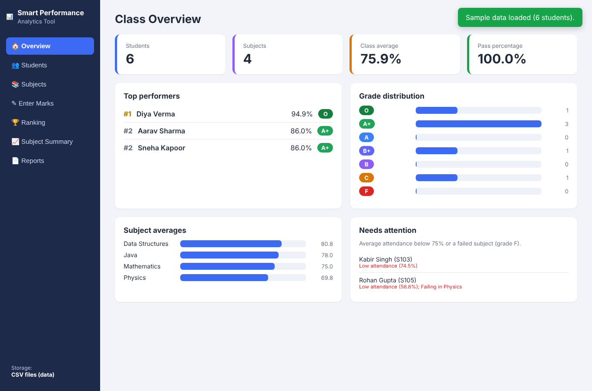
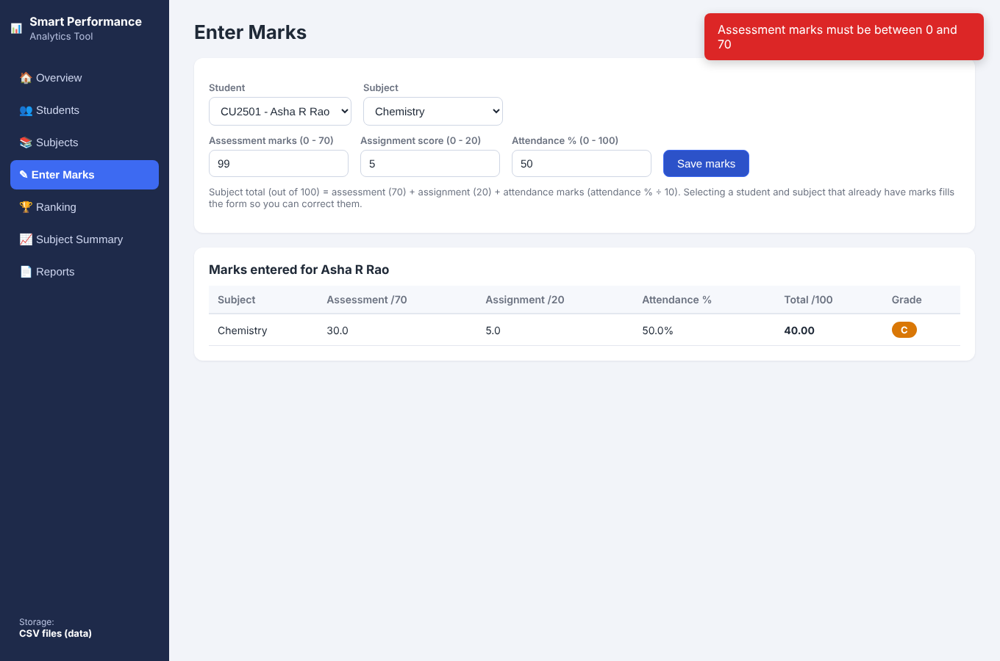

# Smart Performance Analytics Tool

**Course:** Programming in Java (25CSE0202) | **Evaluation:** CE3 – Project Milestone | **Project No.:** 16
**Team:** _<Group number>_ — _<Member 1 (roll no.)>, <Member 2>, <Member 3>, <Member 4>_

A Java application with a **web dashboard for teachers**. It stores student marks, assignment scores and
attendance, then calculates totals, averages, percentages and grades, ranks students, shows subject-wise
summaries and exports reports. Data is saved in **MySQL through JDBC** (or in CSV files when MySQL is not available).

| Overview | Enter marks |
|---|---|
|  |  |

More screenshots: `docs/screenshots/` (students, ranking, reports).

---

## 1. Problem Statement

Teachers usually keep student marks, assignment scores and attendance in separate registers or spreadsheets.
Totalling, grading, ranking and comparing subjects by hand is slow and error-prone, and mistakes such as a mark
above the maximum go unnoticed.

**Intended users:** class teachers / faculty coordinators who need a quick, reliable view of class performance.
**Need addressed:** one tool that validates entered data, computes results consistently, highlights students who
need attention and produces ready-to-share reports.

## 2. Objectives and Scope

| # | Measurable objective | Status |
|---|----------------------|--------|
| O1 | Register students (unique roll number + name) and manage subjects | Done |
| O2 | Record assessment marks, assignment scores and attendance per student per subject | Done |
| O3 | Reject invalid input (non-numeric, out of range, duplicate roll number) with clear messages | Done |
| O4 | Calculate subject total (out of 100), student total, average and percentage automatically | Done |
| O5 | Assign a letter grade (O, A+, A, B+, B, C, F) through a replaceable grading policy | Done |
| O6 | Rank students (equal percentages share a rank) | Done |
| O7 | Subject-wise summary: average, highest, lowest, pass %, topper | Done |
| O8 | Export reports: class report (.txt), student report (.txt), ranking (.csv) | Done |
| O9 | Teacher dashboard in HTML/CSS/JavaScript connected to the Java backend | Done |
| O10 | Persist data in MySQL using JDBC (CSV fallback) | Code written; **see "Testing status" – not yet run against a real MySQL server** |

**Marks model (per subject, total = 100):** assessment 70 + assignment 20 + attendance 10
(attendance marks = attendance % ÷ 10).
**Overall percentage** = average of the student's subject totals.
**Grades:** O ≥ 90, A+ ≥ 80, A ≥ 70, B+ ≥ 60, B ≥ 50, C ≥ 40, F < 40.
**Needs attention:** average attendance below 75% or a failed subject (grade F).

**Out of scope:** user login, several classes/semesters, editing the weightage of marks from the screen.

## 3. How the Parts Fit Together

```
 Browser (web/index.html + style.css + app.js)
        |   fetch()  -> /api/students, /api/marks/save, ...   (JSON over HTTP)
        v
 Java web server  (com.analytics.web: WebServer, ApiHandler, StaticFileHandler)
        |
        v
 StudentManager  +  AnalyticsService  +  ReportExporter       (the same classes the console menu uses)
        |
        v
 DataStore interface  ->  JdbcDataStore (MySQL)   or   CsvDataStore (files in data/)
```

The web server is the `com.sun.net.httpserver` package that comes with the JDK, so no extra libraries are needed
except the MySQL driver. The browser never calculates anything: totals, grades and ranks all come from Java.

### Package structure
```
src/com/analytics
├── Main.java                 entry point: reads config, picks MySQL or CSV, starts dashboard or console
├── model/                    Person (abstract) → Student, SubjectRecord, Grade (enum), Reportable (interface)
├── exception/                InvalidMarksException, StudentNotFoundException,
│                             DuplicateStudentException, DataStorageException
├── service/                  StudentManager, AnalyticsService, GradingPolicy (interface),
│                             StandardGradingPolicy, RankEntry, SubjectStats
├── storage/                  DataStore (interface), JdbcDataStore (MySQL), CsvDataStore (files)
├── util/                     Validator, ReportExporter, SampleData
├── web/                      WebServer, ApiHandler, StaticFileHandler, JsonUtil
└── ui/                       ConsoleMenu (optional text interface)
web/                          index.html, style.css, app.js  (the dashboard)
config/app.properties         database and port settings
database/schema.sql           MySQL tables (the program also creates them automatically)
tests/                        AnalyticsTests (unit), IntegrationTest (whole application over HTTP)
```

### Database tables (MySQL)
| Table | Columns |
|-------|---------|
| `students` | `roll_no` (primary key), `name` |
| `subjects` | `subject_name` (primary key) |
| `marks` | `roll_no`, `subject_name`, `assessment`, `assignment`, `attendance` — primary key (`roll_no`, `subject_name`), foreign keys to the two tables above |

**Design choice:** every change saves the complete data in **one JDBC transaction** (delete all rows, insert all rows;
if anything fails the transaction is rolled back). This keeps the code short and always consistent, and is fast
enough for a class-sized amount of data. See "Pending work" for the alternative.

## 4. Course Concepts Used

| Syllabus topic | Where it is used |
|----------------|------------------|
| Classes, objects, constructors, `this` | `Student`, `SubjectRecord`, all service classes |
| `static` | `Student.studentCount`, `SubjectRecord.MAX_*` constants, `AnalyticsService.ATTENDANCE_LIMIT`, `Validator`, `SampleData` |
| Inheritance & polymorphism | `Student extends Person` (overrides `getRole()`); `GradingPolicy` and `DataStore` have interchangeable implementations |
| Abstraction / interfaces | `Person` (abstract), `Reportable`, `GradingPolicy`, `DataStore` |
| Enums | `Grade` |
| Collections | `TreeMap`, `TreeSet`, `LinkedHashMap`, `HashMap`, `ArrayList`, `EnumMap`, `Comparator` sorting |
| Multi-dimensional arrays | `AnalyticsService.buildMarksMatrix()` builds a `double[][]` (student × subject) for the subject statistics; `SampleData` |
| Strings, `StringBuilder`, formatting | `ReportExporter`, `JsonUtil`, `Validator.normalizeSubject()`, regular-expression checks |
| Wrapper classes | `Double.valueOf` in `Validator`, `Integer::sum` in `AnalyticsService` |
| Exception handling | custom checked exceptions, `try / catch / finally`, multi-catch, `throws`, try-with-resources, transaction rollback |
| JDBC | `JdbcDataStore`: `DriverManager`, `PreparedStatement`, batch inserts, transactions (`commit` / `rollback`), `ResultSet` |
| File persistence | `CsvDataStore` (NIO `Files`, `BufferedReader` / `BufferedWriter`) |
| Networking / web | `WebServer`, `ApiHandler` (HTTP server, request parameters, JSON responses) |
| Testing & validation | `Validator`, `tests/AnalyticsTests.java`, `tests/IntegrationTest.java` |

## 5. Setup and Run

### Requirements
* **JDK 17 or newer** (`javac -version` should work in a terminal)
* A web browser
* **MySQL 8** and the MySQL connector jar — *optional*; without them the program uses CSV files automatically

### Option A – run with CSV files (no database, works immediately)
1. In `config/app.properties` set `db.enabled=false` (or just leave it: if MySQL is not reachable the program says so and uses CSV files).
2. Run `run.bat` (Windows) or `./run.sh` (Linux / Mac).
3. Open **http://localhost:8080** in your browser.

### Option B – run with MySQL
1. Install **MySQL Community Server 8** and make sure it is running. Remember the password of the `root` user.
2. Download the **MySQL Connector/J** jar (see `lib/README.txt`) and copy `mysql-connector-j-<version>.jar` into the `lib` folder.
3. Open `config/app.properties` and set `db.enabled=true`, `db.user` and `db.password` (the `db.url` normally needs no change).
   The database `smart_analytics` and its three tables are created automatically.
   (Optional: you can create them yourself with `mysql -u root -p < database/schema.sql`.)
4. Run `run.bat` / `./run.sh`. The first lines of output must say **`Connected to MySQL.`** and the dashboard shows
   **Storage: MySQL database** at the bottom of the sidebar.
   If you see `MySQL is not available: ...`, read the reason that follows (wrong password, MySQL not running, jar missing) and fix it.
5. Open **http://localhost:8080**.

To check the data in MySQL: `mysql -u root -p smart_analytics` then `SELECT * FROM marks;`

### Commands
| Task | Windows | Linux / Mac |
|------|---------|-------------|
| Compile | `build.bat` | `./build.sh` |
| Run dashboard | `run.bat` | `./run.sh` |
| Run console menu | `run.bat console` | `./run.sh console` |
| Run all tests | `run_tests.bat` | `./run_tests.sh` |

Stop the program with **Ctrl+C**. Do not run the console menu and the dashboard at the same time (they would overwrite each other's saved data).
To use another port, change `server.port` in `config/app.properties`.

## 6. Using the Dashboard

1. **Overview** – numbers for the whole class, top performers, grade distribution, subject averages and students who need attention. A button on an empty system loads sample data for a quick demo.
2. **Students** – register students (roll number + name), search, view a student's popup, rename or delete.
3. **Subjects** – add or delete subjects (deleting a subject removes its marks).
4. **Enter Marks** – pick a student and a subject, enter assessment (0–70), assignment (0–20) and attendance (0–100). If marks already exist the form is filled so they can be corrected. The total and grade are calculated and shown immediately.
5. **Ranking** and **Subject Summary** – always up to date.
6. **Reports** – preview or download the class report, a student report, or the ranking as CSV (opens in Excel).

## 7. API Reference (used by the dashboard)

| Method | Address | Purpose |
|--------|---------|---------|
| GET | `/api/dashboard` | overview numbers, top 3, grade distribution, attention list |
| GET | `/api/students` | all students with totals, percentage, grade, rank |
| GET | `/api/student?roll=` | one student with every subject record |
| POST | `/api/student/add` · `/rename` · `/delete` | `roll`, `name` |
| GET | `/api/subjects` | subjects with number of students |
| POST | `/api/subject/add` · `/delete` | `name` |
| POST | `/api/marks/save` | `roll`, `subject`, `assessment`, `assignment`, `attendance` |
| POST | `/api/marks/delete` | `roll`, `subject` |
| GET | `/api/ranking` · `/api/summary` | rank list · subject-wise summary |
| GET | `/api/report/class` · `/api/report/student?roll=` | text reports (`&download=1` downloads) |
| GET | `/api/export/ranking.csv` | ranking as CSV |
| POST | `/api/sample/load` | replace all data with sample data |

Errors come back as `{"error": "..."}` with status 400 (invalid input), 404 (not found), 409 (duplicate) or 500 (storage problem).
The server only listens on `localhost`, and it rejects POST requests that come from another website.

## 8. Testing Status

Run `run_tests.bat` / `./run_tests.sh` to repeat the first two items.

| Test | What it covers | Result when last run |
|------|----------------|----------------------|
| `AnalyticsTests` (35 checks) | marks calculation, grade boundaries, ranking with ties, subject statistics, validation, subject/marks management, CSV save and reload | all passed |
| `IntegrationTest` (51 checks) | starts the real web server and uses it over HTTP: dashboard files, registration, subjects, marks, automatic calculations, ranking, summary, reports, CSV export, edit/delete, error codes, blocked cross-site request, **data still present after a server restart** | all passed |
| Browser test of the dashboard (36 checks) | headless Chromium clicking through every page: forms, search, popup, prefill of marks, error messages, downloads, mobile layout, no JavaScript errors | all passed (this script is not part of the project folder) |
| MySQL / JDBC | `JdbcDataStore` compiles. The exact SQL statements were run in SQLite (same standard SQL) and worked. | **Not run against a real MySQL server** — it was developed on a computer without MySQL. Please run Option B once and check that the first output line says `Connected to MySQL.`; report any error text you see. |

## 9. Known Limitations and Pending Work

- [ ] **MySQL not yet verified on a real server** (see above).
- [ ] `JdbcDataStore.save()` rewrites all rows on every change. Per-row `INSERT` / `UPDATE` / `DELETE` statements would scale better for large data.
- [ ] If saving fails (for example MySQL stops), the change is already in memory and the screen shows an error; restarting reloads the last saved state.
- [ ] No login / user accounts; anybody who can open `localhost:8080` on this computer can edit data.
- [ ] Subject weightage (70/20/10) and the 75% attendance limit are fixed in code.
- [ ] Students are compared by the average of the subjects entered for them, so a student with fewer subjects entered is ranked on those only.
- [ ] Idea for later: import marks from an Excel/CSV file, charts per student, semester-wise results.

## 10. Rubric Mapping (CE3 – 25 marks)

| Rubric component | Marks | Where to look |
|------------------|-------|---------------|
| Problem Statement | 3 | Section 1 |
| Objectives and Scope | 2 | Section 2 |
| Design & Prototype | 9 | Sections 3 and 6, the running dashboard, `docs/screenshots/` |
| Integration of Course Concepts | 6 | Section 4 |
| Code Quality, Progress & Documentation | 5 | Clean packages, tests (Section 8), this README, Git history, Sections 5, 8, 9 |

## 11. Milestone History

| Milestone | Work done |
|-----------|-----------|
| 1 | Console prototype: model classes, validation, calculations, ranking, summaries, CSV persistence, report export, unit tests |
| 2 | Subject management, edit/delete, automatic saving inside `StudentManager`, `DataStore` interface with `JdbcDataStore` (MySQL), web server and API, HTML/CSS/JS teacher dashboard, integration test, setup guide |

## 12. Team Contributions

| Member | Roll no. | Contribution |
|--------|----------|--------------|
| | | |
